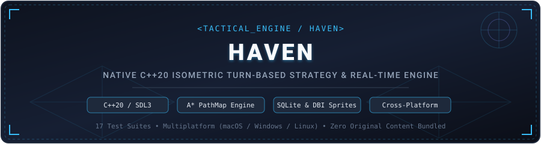
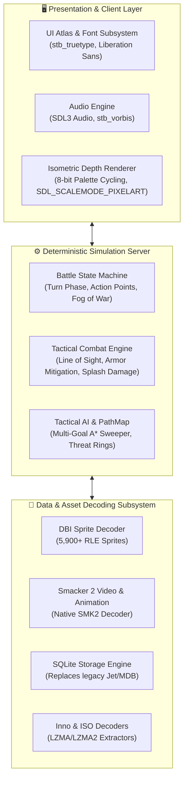

<p align="center">
  
</p>

<p align="center">
  <a href="https://github.com/Rithikasri-code/haven/actions"></a>
  
  
  
  
  <a href="LICENSE"></a>
</p>

---

## 📌 Overview

**Haven** is a high-performance, native open-source reimplementation of the classic 1998 isometric turn-based tactical strategy engine (*Fallen Haven: Liberation Day*), developed in the design spirit of modern engine preservation projects like **OpenRA**, **OpenXcom**, and **fheroes2**.

Engineered entirely from the ground up in modern **C++20** with **SDL3**, the engine provides native, cross-platform execution on **macOS (Apple Silicon arm64)**, **Windows (x64)**, and **Linux (x64)** without emulators or legacy compatibility layers.

> [!NOTE]
> **Strict Cleanroom Engineering:** Haven contains **zero proprietary game assets**. No original executables, sound files, graphics, or databases are bundled in the repository or releases. All sprites, cinematics, and campaign parameters are dynamically decoded at runtime from legitimate game data files or synthetic test suites.

---

## 🏗️ System Architecture



---

## ⚡ Core Technical Capabilities

* **Modern C++20 Core:** Strict modular architecture leveraging modern standard library constructs, concepts, atomic state machines, and RAII resource management.
* **Deterministic Server-Client Separation:** Even in single-player and hot-seat skirmish modes, simulation state runs through a decoupled request-event messaging pipeline (`BattleState` ↔ `applyEvent`), paving the way for multi-client networking.
* **Advanced Tactical AI & A\* PathMap:**
  * Multi-target inverted distance transform and sweeping pathfinding (`PathMap`).
  * Phase-driven threat assessment: target priority weighting, move-to-fire ring calculation, and patrol/escort group behaviors.
* **Isometric Sorting & Depth Engine:**
  * Dynamic per-tile isometric depth sorting supporting bridges, multicarrier vehicles, damage-based wall crumbling, and surface fire effects across all 114 maps.
  * Real-time 18-step 100ms palette-cycling water and energy animation (`PALCYCLE`).
* **High-Throughput Asset Extractors:**
  * Proprietary format decoders written without external runtime dependencies (`.DBI` 8-bit RLE sprites, `.FF` / `.SMK` video streams, `.PAL` color banks).
  * Automated migration pipeline from legacy MS Access/Jet `.MDB` databases into relational SQLite 3 schemas.

---

## 🧪 Comprehensive Verification Suite

Retro RTS includes **17 isolated unit and integration test suites** executed on every commit via GitHub Actions:

| Test Suite | Subsystem Validated |
| :--- | :--- |
| `battle_test` | AP consumption, combat line-of-fire, reaction fire, and objective evaluations |
| `campaign_test` | Strategic colony state transitions, tech trees, and city-building grids |
| `dbi_test` | Sprite unpack verification, color-key integrity, and bounding box metrics |
| `ff_test` | Smacker video chunking, audio synchronization, and keyframe transparency |
| `map_test` | Isometric tile coordinate projection and obstacle traversability matrices |
| `install_test` | Inno Setup LZMA/LZMA2 archive extraction and checksum verification |
| `save_test` | Atomic game state serialization, RNG recovery, and backwards compatibility |

---

## 🚀 Quickstart & Building

### Prerequisites
* **CMake 3.25+**
* **C++20 Compliant Compiler** (MSVC 2022/2026, Clang 16+, GCC 13+)
* **Dependencies:** SDL3 and SQLite3 are automatically fetched and pinned with cryptographic SHA hashes via CMake `FetchContent`.

### Windows (PowerShell)
```powershell
# Build and run the test suite with a single command
.\build.ps1 -RunTests
```

### macOS & Linux
```bash
chmod +x build.sh
./build.sh --test
```

### Docker (Headless Linux Build & Test)
Compile and verify all 17 test suites in an isolated container without local C++ toolchains:
```bash
docker build -t haven .
```

---

## 🛠️ Debugging & Agent Tooling (Built-in MCP Server)

Retro RTS features an internal **Model Context Protocol (MCP)** server for AI-driven automated testing and headless integration:

```bash
# Launch engine with MCP server enabled on localhost
./openday --mcp --mcp-port 47800
```
Allows external agents or automation scripts to:
* Capture 8-bit indexed compressed PNG screenshots.
* Inspect live simulation state (`battle_state`, units, pathfinder graphs).
* Inject deterministic commands (Move, Fire, Deploy, EndTurn).

---

## 📄 Licensing & Disclaimers

* **Source Code:** Released under the **GNU General Public License v3.0 (GPL-3.0)**. See [LICENSE](LICENSE) for details.
* **Third-Party Code:** Contains permissive libraries documented in [THIRD_PARTY.md](THIRD_PARTY.md).
* **Trademark Notice:** *Fallen Haven* and *Liberation Day* are trademarks of their respective copyright holders. This project is an independent cleanroom reimplementation and is not affiliated with, endorsed by, or connected to the original publishers.
